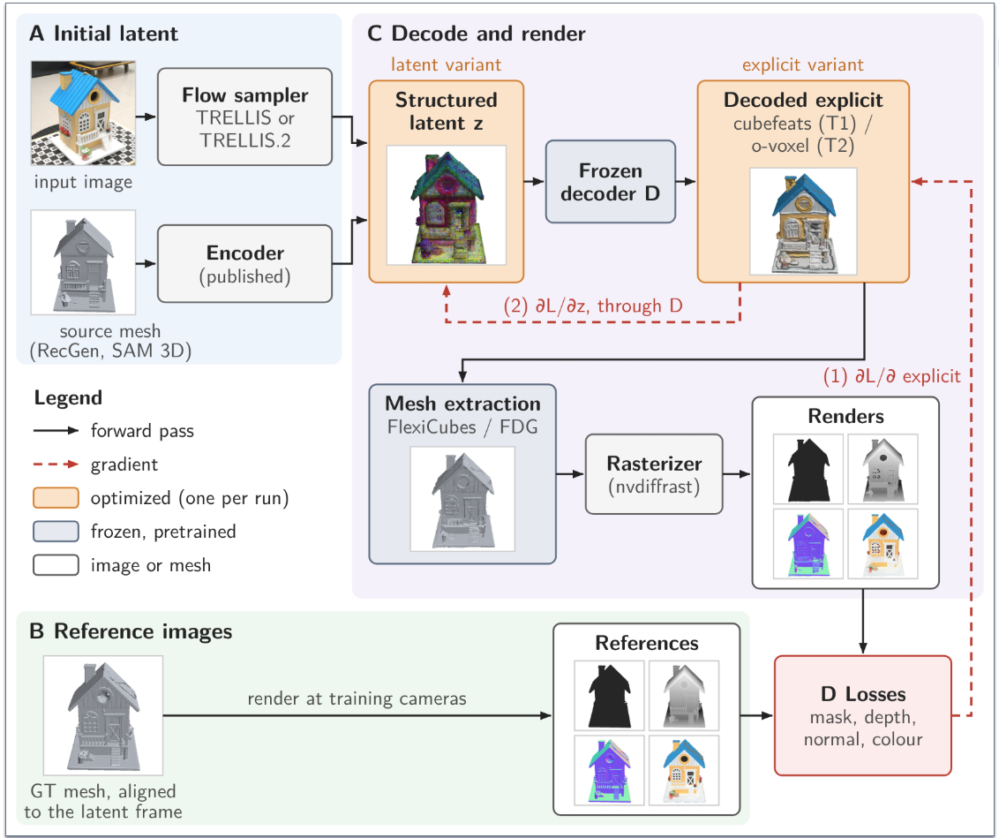

# 3D Object Reconstruction via Latent Priors and Rendering


Refining the latents of image-to-3D generative models (feed forward models) with inverse rendering loss, benchmarked with Stanford-ORB on DTC objects.

Please note, some files and folders have been omitted before uploading to github, due to their size



## Layout

| path | contents |
|---|---|
| `benchmark/` | baseline generation, Stanford-ORB benchmark, figures and tables |
| `trellis1/TRELLIS/` | TRELLIS + refinement code (`slat_optimization.py`, `slat_opt/` incl. dilation, `cubefeats_opt/`, `flexicubes/`) |
| `trellis2/TRELLIS.2/` | TRELLIS.2 + refinement code (`slat_opt/`, `topology_study/`) |
| `recgen/`, `sam3d/` | generative baselines |
| `nvdiffrec/`, `nvdiffrecmc/` | multi-view optimization baselines |
| `hunyuan3d/` | Hunyuan3D-2 checkout (not part of the benchmark) |
| `Stanford-ORB/` | ORB metric code (unchanged) |
| `dataset/DTC/` | DTC objects: GT mesh, cameras, photos |
| `thesis_app/` | `thesis3d` CLI wrapping all experiments |
| `generative_runs/v2/` | baseline meshes per method and object |
| `benchmark_output/`, `benchmark_output_v2/` | benchmark scores and renders (see Results) |
| `benchmark_images/`, `benchmark_images_v2/` | comparison images from the benchmark renders |
| `thesis_figures/` | figures used in the thesis (re-rendered, PNG + PDF) |
| `tables.md` | appendix tables generated from the benchmark |
| `thesis_runs.sh` | Slurm job running every refinement experiment |
| `thesis_runs_logs/` | per-run logs of that job |
| `run_script.sh`, `trellis_setup.sh`, `job.sh`, `z_scripts.sh` | environment setup and batch scripts |
| `miscellaneous/` | notes, old job logs, runtime table |

Objects: `Birdhouse_Lighting001`, `Cup_B08TWHJ33Q_Tan_Lighting001`, `Figurine_B08FYFNYP4_LionKing_Lighting001`,
`Gargoyle_B08SQMBDXY_HandsOnKnees_Lighting001`, `Mallard_B082D168CK_MintGreen_Lighting001`, `Mouse_B0CHNVBBLF_Honeycomb_1_Lighting001`.

## Environments

| env | CUDA | used for |
|---|---|---|
| `trellis` | 12.8 | TRELLIS generation and refinements (H100 only) |
| `trellis2` | 12.8 | TRELLIS.2 generation and refinements, benchmark, figures |
| `recgen` | 11.8 | RecGen (pixi project) |
| `sam3d` | 12.8 | SAM3D |

## Baselines

```bash
python benchmark/run_all.py                      # generate + benchmark every method
python benchmark/run_all.py --methods trellis2
python benchmark/run_all.py --skip-generate      # re-score existing meshes
```

## Experiment 1: TRELLIS SLAT refinement

```bash
cd trellis1/TRELLIS
python slat_optimization.py --yaml-config yaml_config/config.yaml
```

## Experiment 2: refinement of encoded reconstructions

```bash
sbatch thesis_runs.sh                    # all variables, sources and objects
python benchmark/run_all_opt.py          # benchmark the refined meshes
```

Per variable: see `trellis1/TRELLIS/slat_opt/`, `trellis1/TRELLIS/cubefeats_opt/`, `trellis1/TRELLIS/flexicubes/` and `trellis2/TRELLIS.2/slat_opt/`.

## Experiment 3: TRELLIS.2 topology

```bash
cd trellis2/TRELLIS.2
python topology_study/run_both.py --yaml-config topology_study/config.yaml
```

## Experiment 4: growing missing structure by SLAT dilation

```bash
cd trellis1/TRELLIS
sbatch slat_opt/run_slat_dilation.sh                                # all arms: baseline, shell, random, grow, guided
python slat_opt/hypothesis_slat_dilation.py --arms baseline guided   # a subset; --check for a short test
```

Config: `trellis1/TRELLIS/slat_opt_configs/dilation/Birdhouse_chimney.yaml`.

## Results


Each optimization run folder holds `metrics.jsonl`, the meshes and its render panels. Five panels per run (one view, from the first to the last evaluation) were kept in the git commit, in the run's `test/` folder (`region/` for the dilation run); `python benchmark/select_run_images.py --add` selects them.


| experiment | run folders | tracked images |
|---|---|---|
| 1: TRELLIS SLAT | `trellis1/TRELLIS/optimization_output/hypothesis/` | none |
| 2: SLAT (T1) | `trellis1/TRELLIS/optimization_output/slat_opt/v2/slat/<source>/<object>/` | `test/` |
| 2: SLAT (T1), first prompt set | `trellis1/TRELLIS/optimization_output/slat_opt/slat/<source>/<object>/` | `test/` |
| 2: cubefeats (T1) | `trellis1/TRELLIS/optimization_output/cubefeats_opt/v2/<source>/<object>/` | `test/` |
| 2: FlexiCubes | `trellis1/TRELLIS/optimization_output/flexicubes/<source>/<object>/` | `test/` |
| 2: SLAT (T2), o-voxel (T2) | `trellis2/TRELLIS.2/optimization_output/slat_opt/v2/<source>/<object>/{slat,ovoxel}/` | `test/` |
| 3: topology | `trellis2/TRELLIS.2/topology_study/output/Birdhouse_Lighting001/{slat,ovoxel}/` | `test/` |
| 4: dilation | `trellis1/TRELLIS/optimization_output/slat_dilation/Birdhouse_chimney/<arm>/` (`summary.md` one level up) | `region/` |

`<source>` is `recgen`, `sam3d`, `trellis` or `trellis2`; `<arm>` is `baseline`, `shell_r1`, `shell_r2`, `random_r2`, `grow` or `guided`.

Benchmark:

| path | contents |
|---|---|
| `benchmark_output/<method>/scores.json` | per-object and mean Stanford-ORB scores (baselines and the 16 refined methods) |
| `benchmark_output/summary.md` | one row per method |
| `benchmark_output_v2/` | GT-supervised nvdiffrec runs |
| `miscellaneous/z_runtime_table.md` | runtime of nvdiffrec against the refinements |

## Figures and tables

```bash
python benchmark/make_tiles.py --overview
python benchmark/make_tiles.py --overview --experiments trellis1_slat trellis1_cubefeats trellis2_slat trellis2_ovoxel
python benchmark/make_tables.py --out tables.md
```
